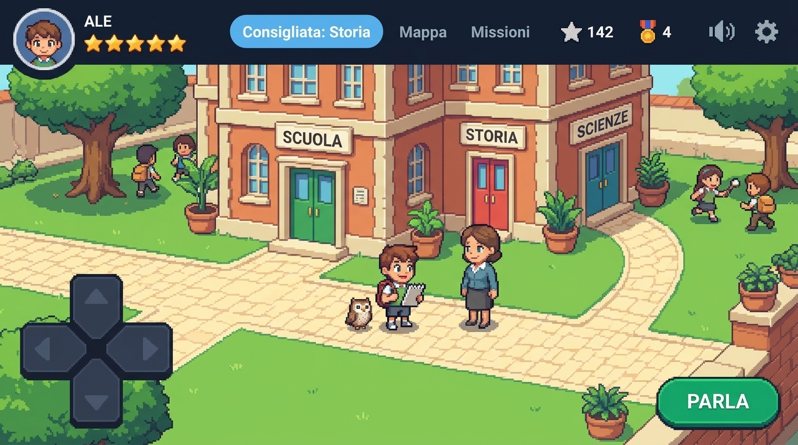
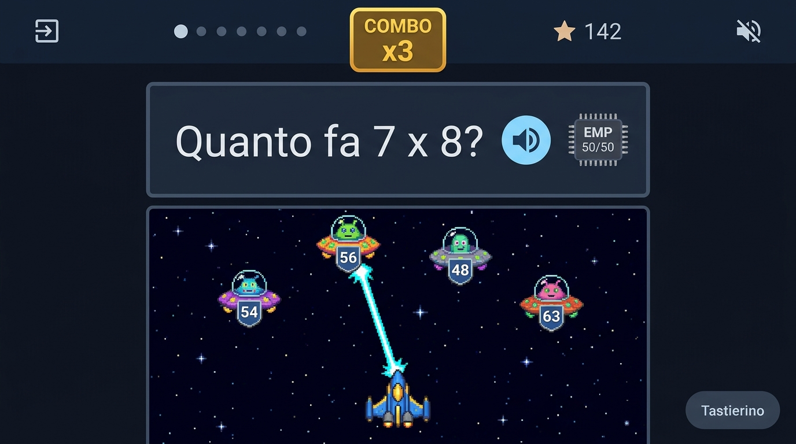

# Maestri di Pixel

**App educativa Android offline-first in pixel-art 16-bit per bambini della 4ª e 5ª elementare**, progettata per tablet in orientamento orizzontale con 6 materie, mini-giochi dedicati, ripetizione spaziata (metodo Leitner), Area Genitori protetta da PIN e sincronizzazione di pacchetti didattici da GitHub.


---

## Anteprima



| Sfida RPG nel Cortile | Palestra Spaziale (Matematica) |
| :---: | :---: |
|  |  |
| *Battaglie a turni stile GBA con focus mode, indizi, TTS e feedback positivo.* | *Arcade spaziale a 60 fps per tabelline e calcoli, con EMP 50/50 e tastierino opzionale.* |

| Armadietto, Medaglie e Spaccio Ricompense |
| :---: |
|  |
| *Medaglie sbloccabili dai Boss delle materie, armadietto personalizzabile con adesivi, cappelli e compagni pixel-art.* |

---

## Funzionalità principali

### Mondo esplorabile 16-bit (Cortile & Atrio Scuola)
- **Mappa edge-to-edge adattiva**: la scena 16-bit si adatta dinamicamente alla risoluzione del tablet estendendo naturalmente i bordi del prato e dell'atrio senza bande nere.
- **Doppio controllo**: movimento **Tap-to-Walk / Tap-to-Interact** (basta toccare maestri, porte o sentieri) affiancato da un **D-Pad semitrasparente** opzionale nella zona naturale del pollice sinistro e pulsante contestuale di azione a destra.
- **Barra HUD superiore separata**: sempre ordinata e ben distanziata dalla mappa, con profilo esploratore, timbri settimanali, materia consigliata, accesso a Mappa rapida, Missioni giornaliere, contatori Stelle/Medaglie, tasto Audio rapido e accesso Area Genitori.

### 6 Materie e Mini-Giochi dedicati

| Materia | Aula / Ambientazione | Meccanica di gioco |
| :--- | :--- | :--- |
| **Storia** | Cortile & Aula Storia | Battaglia RPG a turni stile GBA (Attacco Base / Mossa Speciale, barre HP, sfide Boss). |
| **Matematica** | Palestra Spaziale | Arcade *Space Invaders* a 60 fps per tabelline e calcoli, con impulso **EMP 50/50** e **Tastierino numerico** attivabile. |
| **Scienze** | Catapulta di Scienze | Lancio parabolico con fisica 2D a 60 fps per abbattere bersagli rispondendo alle domande scientifiche. |
| **Italiano** | Biblioteca Magica | Caccia ai libri alati a 60 fps tra scaffali in rovere per esercitare grammatica, verbi e ortografia. |
| **Geografia** | Aula di Geografia | Volo in mongolfiera a 60 fps tra varchi nelle nuvole sopra Alpi e Mediterraneo. |
| **Inglese** | Aula di Inglese | Abbinamento lampo bilingue con pronuncia vocale integrata (TTS inglese e italiano). |

### Apprendimento efficace e non punitivo
- **Ripetizione spaziata (Metodo Leitner)**: le domande vengono classificate automaticamente nei box 1–3 per riproporre con priorità i concetti da consolidare.
- **Gestione serena dell'errore**: nessun "game over" punitivo; in caso di risposta sbagliata l'app mostra una spiegazione breve e incoraggiante e reinserisce la domanda più avanti nella sessione.
- **Sintesi vocale (TTS) con Audio Ducking**: lettura ad alta voce di domande e spiegazioni con attenuazione automatica della musica di sottofondo.

### Design inclusivo (BES & ADHD) e Profilo "Studio Sereno"
- **Tema Scuro anti-abbagliamento di default** (con selettore Scuro/Chiaro nelle Impostazioni): superfici blu notte e ardesia (`#141e30` / `#1e293b`) con testo bianco ghiaccio (`#f1f5f9`) per ridurre l'affaticamento visivo su tablet.
- **Tipografia ad alta leggibilità**: utilizzo di font `Atkinson Hyperlegible` per tutti i testi di lettura, etichette delle aule, HUD e quiz, evitando font pixelati dove serve leggere velocemente.
- **Profilo "Studio Sereno" (1 tocco)**: attiva simultaneamente *Ritmo Calmo* (velocità ridotta nei mini-giochi arcade), pausa di lettura (1s/2s), animazioni ridotte, aiuto 50/50 e TTS automatico.

### Armadietto, Medaglie e Spaccio Ricompense
- **Bacheca Medaglie**: medaglie dorate ottenute sconfiggendo i Maestri Boss di ciascuna materia.
- **Il Mio Armadietto**: 6 slot personalizzabili per esporre adesivi pixel-art, cappelli indossabili per l'avatar, compagni animati che ti seguono nell'Hub e cornici profilo.
- **Spaccio Ricompense**: spendi le stelle guadagnate studiando per sbloccare nuovi oggetti cosmetici.

### Area Genitori protetta da PIN
Accessibile tenendo premuta per **2 secondi** l'icona ingranaggio nella barra superiore e inserendo il PIN (predefinito `1234`, modificabile dalle impostazioni):
- **Progressi**: percentuale di padronanza per materia, elenco delle 5 domande più ostiche secondo il motore Leitner e storico delle ultime 10 sessioni.
- **Pacchetti & Sync**: sincronizzazione da repository GitHub, importazione locale di pacchetti `.json` (da file o appunti), attivazione del flag **Verifica!** (badge prioritario e bonus stelle `x1.5`) e selezione fine degli argomenti per singola materia.
- **Impostazioni**: gestione multi-profilo (ideale per fratelli sullo stesso tablet), tema Scuro/Chiaro, lunghezza sessione (4 / 6 / 8 domande), profili audio, Studio Sereno e reset con doppia conferma.

---

## Pacchetti didattici e Sincronizzazione GitHub

L'app include già i pacchetti base per tutte e 6 le materie e funziona **100% offline**. Per aggiungere nuovi capitoli del sussidiario o preparazioni alle verifiche senza ricompilare l'app, è incluso il template pronto all'uso nella cartella [`github_packs_repo_template/`](github_packs_repo_template/):

1. Crea un repository GitHub (pubblico o privato) partendo dal contenuto di `github_packs_repo_template/`.
2. Aggiungi o modifica i file JSON nella cartella `packs/` rispettando gli schemi ufficiali in `github_packs_repo_template/schemas/`.
3. Valida ogni pacchetto prima del caricamento con lo script incluso:
   ```bash
   python3 github_packs_repo_template/validate_pack.py github_packs_repo_template/packs/<tuo_pacchetto>.json
   ```
4. Configura repository e (se privato) il Fine-grained Personal Access Token (permesso `Contents: Read-only`) direttamente in **Area Genitori → Impostazioni**, oppure tramite la variabile `GITHUB_PACKS_PAT` definita in `.env` (vedi `.env.example`).

Per la guida passo-passo completa consulta [`github_packs_repo_template/README.md`](github_packs_repo_template/README.md).

---

## Stack tecnologico e Struttura

- **Linguaggio**: Kotlin
- **UI**: Jetpack Compose + Material Design 3
- **Asincronia & Stato**: Kotlin Coroutines, `StateFlow`, architettura MVVM
- **Rete (opzionale per sync pacchetti)**: OkHttp
- **Test**: JUnit 4, Kotlin Coroutines Test, Robolectric + Compose UI Test

```text
.
├── app/src/main/java/com/example/
│   ├── MainActivity.kt          # Entry point edge-to-edge & gestione lifecycle audio/TTS
│   ├── core/                    # Modelli dati, motore Leitner, persistenza locale, audio/TTS, sync GitHub
│   ├── pixelart/                # Motore grafico 16-bit Canvas, sprite, mappe e animazioni
│   ├── ui/
│   │   ├── components/          # Componenti GBA/M3 condivisi, modali, D-Pad e tastierino
│   │   ├── screens/             # Hub, 6 mini-giochi, Armadietto, Area Genitori, Profili
│   │   └── theme/               # Palette anti-abbagliamento Scuro/Chiaro e tipografia Atkinson Hyperlegible
│   └── viewmodel/               # Stato centralizzato della sessione e dei profili
├── docs/screenshots/            # Schermate dimostrative per la documentazione
├── github_packs_repo_template/  # Template repository pacchetti JSON + schemi e validatore Python
└── BUILD_ANDROID.md             # Guida compilazione e checklist QA su tablet
```

---

## Compilazione e Test

Per istruzioni dettagliate e checklist QA su tablet consulta [`BUILD_ANDROID.md`](BUILD_ANDROID.md).

### Compilare l'APK di debug
```bash
gradle :app:assembleDebug
```

### Eseguire i test unitari e Robolectric
```bash
gradle :app:testDebugUnitTest
```

### Configurazione opzionale del token GitHub
Per pre-configurare un token di lettura in fase di build senza mai inserirlo nel codice sorgente, imposta `GITHUB_PACKS_PAT` nel file `.env` locale (basato su `.env.example`) oppure tramite il pannello Secrets dell'ambiente di build. Se il repository dei pacchetti è pubblico o il token viene inserito direttamente dall'Area Genitori sul tablet, non è necessaria alcuna configurazione aggiuntiva.
