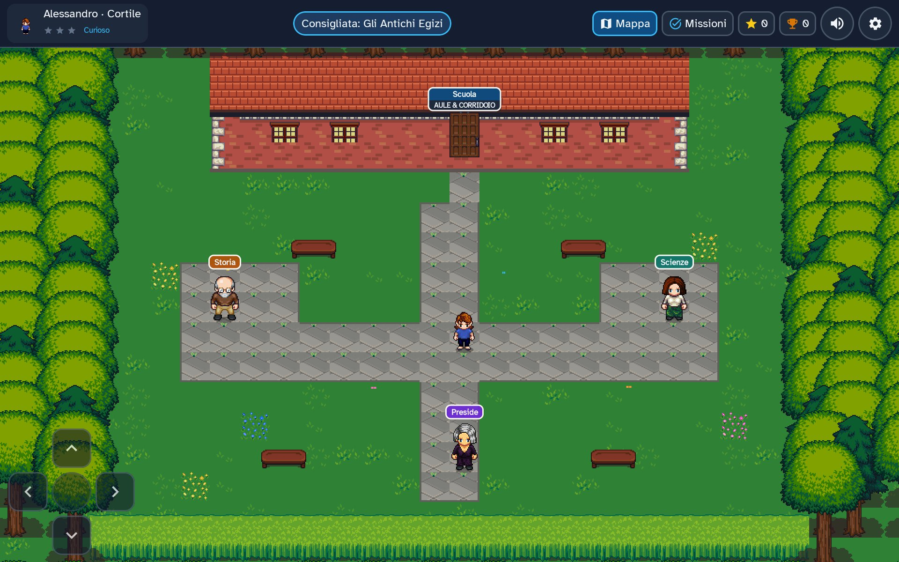
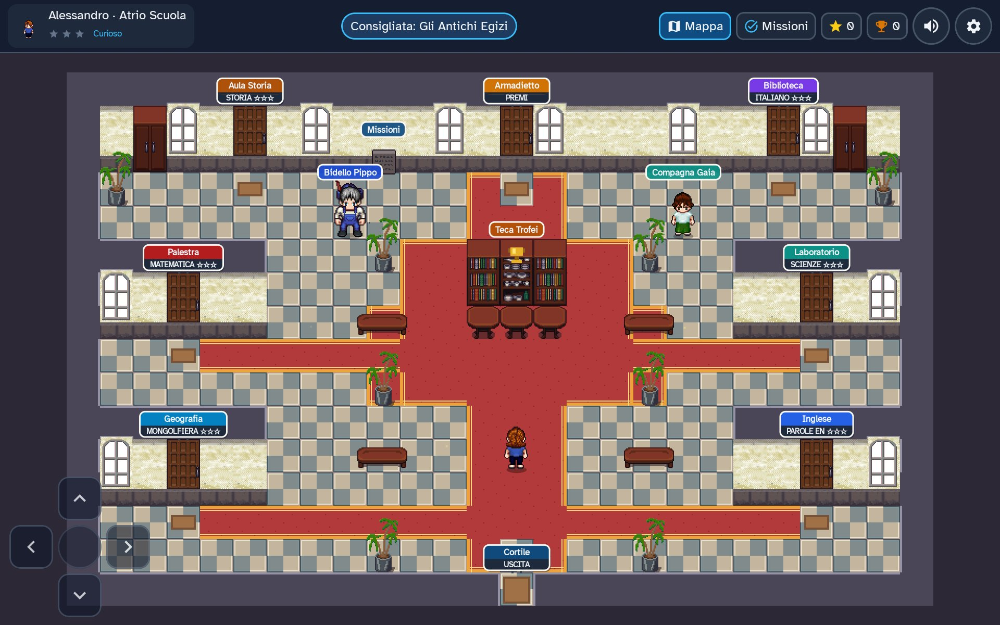
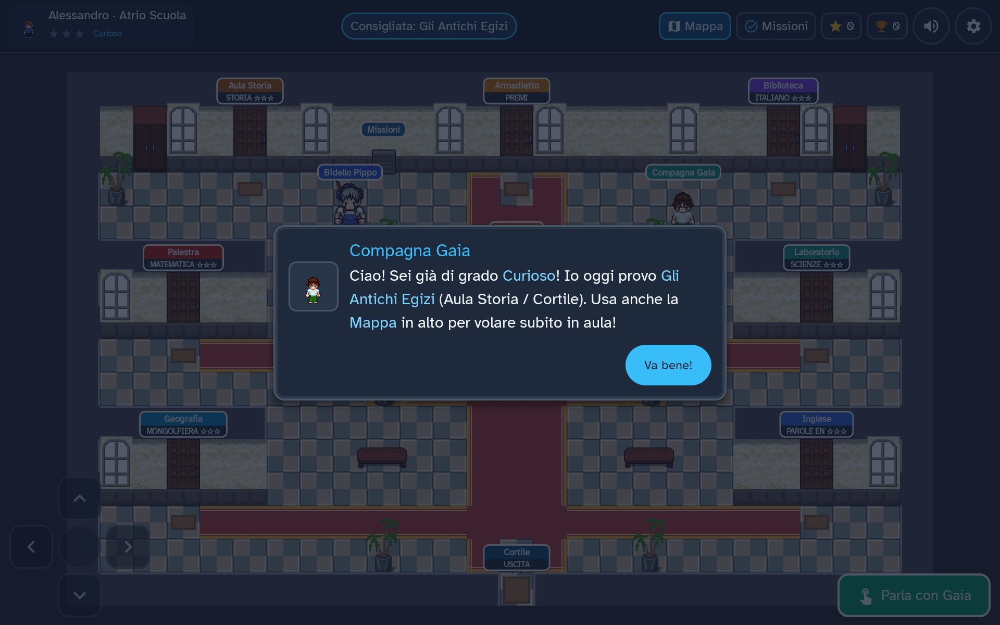
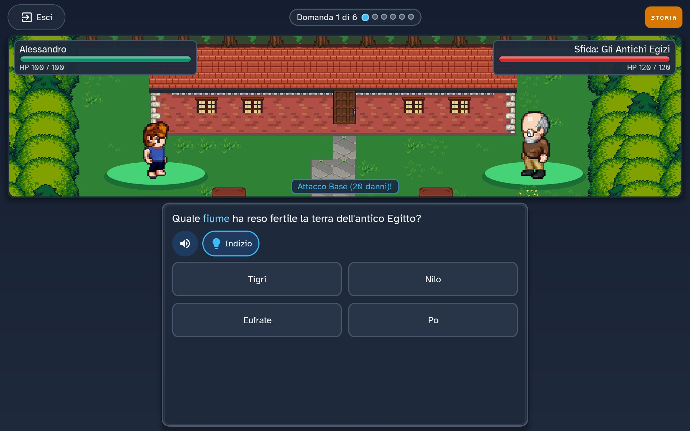
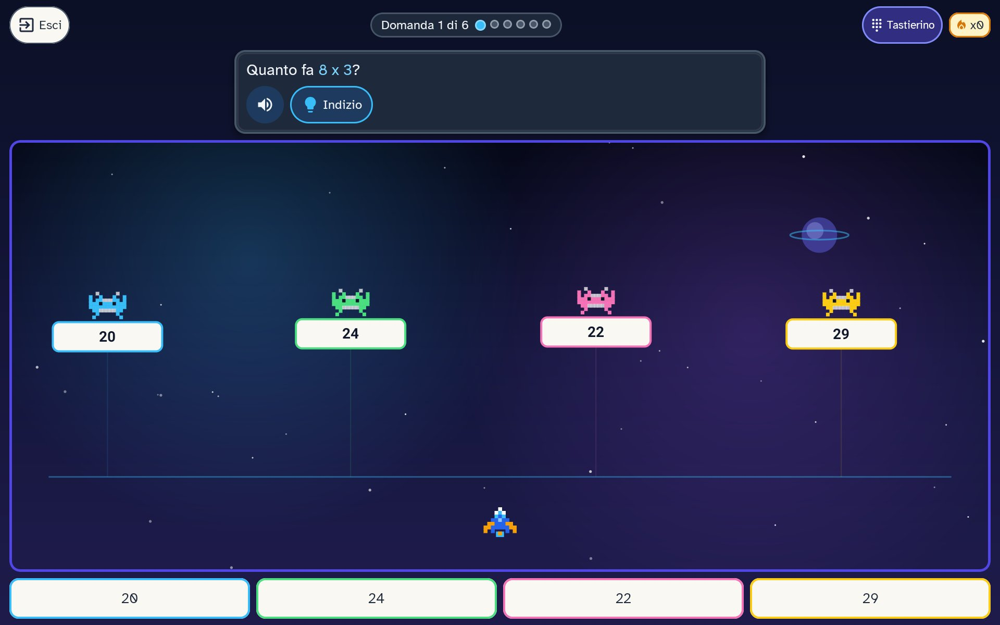
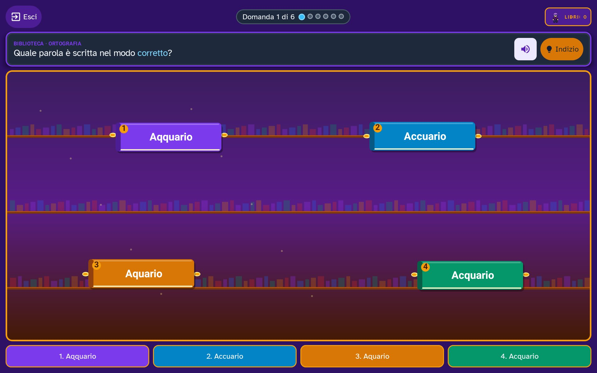

# Maestri di Pixel

<p align="left">
  <a href="https://paypal.me/cannos" target="_blank">
    
  </a>
</p>

**App educativa Android offline-first in pixel-art 16-bit per bambini della 4ª e 5ª elementare**, progettata per tablet in orientamento orizzontale con 6 materie, mini-giochi dedicati, ripetizione spaziata (metodo Leitner), Area Genitori protetta da PIN e sincronizzazione di pacchetti didattici da GitHub.


---

## Anteprima

*Schermate reali dell'app su tablet 1920×1200.*



| Atrio con le aule | Dialoghi con maestri e compagni |
| :---: | :---: |
|  |  |
| *Ogni porta porta a una materia; le targhe mostrano grado e verifiche in arrivo.* | *I personaggi suggeriscono l'attività consigliata del giorno.* |

| Sfida nel Cortile (Storia) | Palestra Spaziale (Matematica) |
| :---: | :---: |
|  |  |
| *Battaglia a turni sullo sfondo del cortile, con indizi e lettura ad alta voce.* | *Arcade per tabelline e calcoli, con tastierino opzionale.* |

| Biblioteca Magica (Italiano) |
| :---: |
|  |
| *Caccia al libro giusto tra gli scaffali per ortografia e grammatica.* |

---

## Funzionalità principali

### Mondo esplorabile 16-bit (Cortile & Atrio Scuola)
- **Grafica pixel-art LPC a 32 px**: personaggi animati nelle 4 direzioni e sfondi dipinti per Cortile e Atrio, ingranditi a fattore intero (×2, ×3…) per pixel sempre nitidi; lo sfondo ha un bordo extra, quindi niente bande nere.
- **Doppio controllo**: movimento **Tap-to-Walk / Tap-to-Interact** (basta toccare maestri, porte o sentieri) affiancato da un **D-Pad semitrasparente** opzionale nella zona naturale del pollice sinistro e pulsante contestuale di azione a destra.
- **Barra HUD superiore separata**: sempre ordinata e ben distanziata dalla mappa, con profilo esploratore, timbri settimanali, materia consigliata, accesso a Mappa rapida, Missioni giornaliere, contatori Stelle/Medaglie, tasto Audio rapido e accesso Area Genitori.

### 6 Materie e Mini-Giochi dedicati

| Materia | Aula / Ambientazione | Meccanica di gioco |
| :--- | :--- | :--- |
| **Storia** | Cortile & Aula Storia | Battaglia RPG a turni stile GBA (Attacco Base / Mossa Speciale, barre HP, sfide Boss). |
| **Matematica** | Palestra Spaziale | Arcade *Space Invaders* a 60 fps per tabelline e calcoli, con impulso **EMP 50/50** e **Tastierino numerico** attivabile. |
| **Scienze** | Catapulta di Scienze | Lancio parabolico con fisica 2D a 60 fps per abbattere bersagli rispondendo alle domande scientifiche. |
| **Italiano** | Biblioteca Magica | Caccia ai libri alati a 60 fps tra scaffali in rovere per esercitare grammatica, verbi e ortografia. |
| **Geografia** | Aula di Geografia | Volo in mongolfiera a 60 fps tra varchi nelle nuvole sopra Alpi e Mediterraneo. |
| **Inglese** | Aula di Inglese | Abbinamento lampo bilingue con pronuncia vocale integrata (TTS inglese e italiano). |

### Apprendimento efficace e non punitivo
- **Ripetizione spaziata (Metodo Leitner)**: le domande vengono classificate automaticamente nei box 1–3 per riproporre con priorità i concetti da consolidare.
- **Gestione serena dell'errore**: in caso di risposta sbagliata l'app mostra una spiegazione breve e incoraggiante e reinserisce la domanda più avanti nella sessione. Solo nella battaglia del Cortile troppi errori esauriscono i punti vita e chiudono la sfida, senza perdere stelle o progressi.
- **Sintesi vocale (TTS) con Audio Ducking**: lettura ad alta voce di domande e spiegazioni con attenuazione automatica della musica di sottofondo.

### Design inclusivo (BES & ADHD) e Profilo "Studio Sereno"
- **Tema Scuro anti-abbagliamento di default** (con selettore Scuro/Chiaro nelle Impostazioni): superfici blu notte e ardesia (`#141e30` / `#1e293b`) con testo bianco ghiaccio (`#f1f5f9`) per ridurre l'affaticamento visivo su tablet.
- **Tipografia ad alta leggibilità**: utilizzo di font `Atkinson Hyperlegible` per tutti i testi di lettura, etichette delle aule, HUD e quiz, evitando font pixelati dove serve leggere velocemente.
- **Profilo "Studio Sereno" (1 tocco)**: attiva simultaneamente *Ritmo Calmo* (velocità ridotta nei mini-giochi arcade), pausa di lettura (1s/2s), animazioni ridotte, aiuto 50/50 e TTS automatico.

### Armadietto, Medaglie e Spaccio Ricompense
- **Bacheca Medaglie**: medaglie dorate ottenute sconfiggendo i Maestri Boss di ciascuna materia.
- **Il Mio Armadietto**: 6 slot personalizzabili per esporre adesivi pixel-art, cappelli indossabili per l'avatar, compagni animati che ti seguono nell'Hub e cornici profilo.
- **Spaccio Ricompense**: spendi le stelle guadagnate studiando per sbloccare nuovi oggetti cosmetici.

### Area Genitori protetta da PIN
Accessibile tenendo premuta per **2 secondi** l'icona ingranaggio nella barra superiore e inserendo il PIN (predefinito `1234`, modificabile dalle impostazioni):
- **Progressi**: percentuale di padronanza per materia, elenco delle 5 domande più ostiche secondo il motore Leitner e storico delle ultime 10 sessioni.
- **Pacchetti & Sync**: stato e avvio manuale della sincronizzazione da GitHub (che parte comunque da sola a ogni avvio), importazione locale di pacchetti `.json` (da file o appunti), attivazione del flag **Verifica!** (badge prioritario e bonus stelle `x1.5`) e selezione fine degli argomenti per singola materia.
- **Impostazioni**: gestione multi-profilo (ideale per fratelli sullo stesso tablet), tema Scuro/Chiaro, lunghezza sessione (4 / 6 / 8 domande), profili audio, Studio Sereno e reset con doppia conferma.

---

## Pacchetti didattici e Sincronizzazione GitHub

L'app include già i pacchetti base per tutte e 6 le materie e funziona **100% offline**. I nuovi capitoli del sussidiario arrivano dal repository [`cyberMelo/maestri-di-pixel-packs`](https://github.com/cyberMelo/maestri-di-pixel-packs), fisso nell'app (`PackManager.LOCKED_GITHUB_*`):

- **A ogni avvio** l'app sincronizza in background (se il repository è privato serve il token, vedi sotto); senza rete usa la cache e continua a funzionare.
- **Scarica solo i file cambiati**, confrontando l'impronta (SHA Git) di ogni file con quella dell'ultimo download: basta caricare il file modificato su GitHub, non serve ricordarsi di alzare `version`.
- **ID domanda unici tra tutti i pacchetti**: i progressi sono salvati per ID, quindi un pacchetto che riusa un ID di un altro pacchetto (anche di quelli inclusi nell'app) viene scartato e l'avviso compare in **Area Genitori → Pacchetti & Sync**.

Prima di caricare, controlla manifest e pacchetti insieme con lo script incluso:
```bash
python3 validate_pack.py --all packs
```
Il template della cartella [`github_packs_repo_template/`](github_packs_repo_template/) è la copia di riferimento di schemi e script.

Per la guida passo-passo completa consulta [`github_packs_repo_template/README.md`](github_packs_repo_template/README.md).

---

## Stack tecnologico e Struttura

- **Linguaggio**: Kotlin
- **UI**: Jetpack Compose + Material Design 3
- **Asincronia & Stato**: Kotlin Coroutines, `StateFlow`, architettura MVVM
- **Rete (opzionale per sync pacchetti)**: OkHttp
- **Test**: JUnit 4, Kotlin Coroutines Test, Robolectric + Compose UI Test

```text
.
├── app/src/main/java/com/example/
│   ├── MainActivity.kt          # Entry point edge-to-edge & gestione lifecycle audio/TTS
│   ├── core/                    # Modelli dati, motore Leitner, persistenza locale, audio/TTS, sync GitHub
│   ├── pixelart/                # Caricamento sprite LPC, piante delle mappe e percorsi (A*)
│   ├── ui/
│   │   ├── components/          # Componenti GBA/M3 condivisi, modali, D-Pad e tastierino
│   │   ├── screens/             # Hub, 6 mini-giochi, Armadietto, Area Genitori, Profili
│   │   └── theme/               # Palette anti-abbagliamento Scuro/Chiaro e tipografia Atkinson Hyperlegible
│   └── viewmodel/               # Stato centralizzato della sessione e dei profili
├── app/src/main/resources/      # maps/*.txt (piante) e sprites/ (personaggi, cappelli, sfondi, crediti)
├── tools/art/                   # Script che compongono personaggi e sfondi dai pacchetti LPC
├── docs/screenshots/            # Schermate reali dell'app
├── github_packs_repo_template/  # Template repository pacchetti JSON + schemi e validatore Python
└── BUILD_ANDROID.md             # Guida compilazione e checklist QA su tablet
```

---

## Grafica

La grafica usa la serie **LPC (Liberated Pixel Cup)**, uno stile pixel-art a 32 px condiviso da molti autori:

- **Personaggi**: composti con `tools/art/build_characters.py` dai livelli del [Universal LPC Spritesheet Character Generator](https://github.com/LiberatedPixelCup/Universal-LPC-Spritesheet-Character-Generator) (corpo da bambino per gli avatar, adulti per maestri e personale). I cappelli dell'armadietto sono livelli separati, già allineati alla testa da bambino.
- **Sfondi**: `tools/art/build_maps.py` dipinge Cortile e Atrio con le piastrelle LPC seguendo le piante in `app/src/main/resources/maps/*.txt`, le stesse che l'app usa per collisioni, porte e personaggi: grafica e logica coincidono sempre.
- **Rigenerare**: scarica i pacchetti indicati in testa agli script e lancia
  ```bash
  python3 tools/art/build_characters.py <generatore_lpc> app/src/main/resources
  python3 tools/art/build_maps.py <cartella_pacchetti_lpc> app/src/main/resources
  ```

### Crediti

Grafica LPC sotto licenze **CC-BY-SA 3.0 / GPL 3.0 / OGA-BY 3.0** (alcuni livelli CC0): gli autori di ogni livello e pacchetto sono elencati in
[`CREDITS-characters.csv`](app/src/main/resources/sprites/CREDITS-characters.csv) e [`CREDITS-maps.txt`](app/src/main/resources/sprites/CREDITS-maps.txt), inclusi anche nell'APK.

---

## Compilazione e Test

Per istruzioni dettagliate e checklist QA su tablet consulta [`BUILD_ANDROID.md`](BUILD_ANDROID.md).

### Compilare l'APK di debug
```bash
gradle :app:assembleDebug
```

### Eseguire i test unitari e Robolectric
```bash
gradle :app:testDebugUnitTest
```

### Token GitHub (necessario finché il repository dei pacchetti è privato)
Imposta un Fine-grained PAT con permesso `Contents: Read-only` sul solo repository `maestri-di-pixel-packs` nella variabile `GITHUB_PACKS_PAT` del file `.env` locale (basato su `.env.example`): viene inserito nell'APK in fase di build, mai nel codice sorgente. Senza token, con il repository privato, la sincronizzazione fallisce con un avviso in Area Genitori e l'app continua a funzionare con i pacchetti inclusi.

---

## ☕ Supporta il progetto

Se Maestri di Pixel aiuta anche i tuoi figli a studiare, puoi offrirmi un caffè: mi aiuta a preparare nuovi capitoli e mini-giochi.

<a href="https://paypal.me/cannos" target="_blank">
  
</a>

[](https://paypal.me/cannos)
